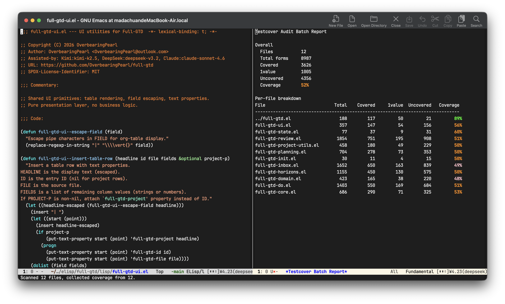

# testcover-audit

**Testcover Audit** adds quantitative coverage statistics to Emacs' built-in `testcover.el`. It shows coverage percentage, counts of covered / uncovered / 1value forms, and can generate per-file and per-function breakdowns.



## Quick start

<pre>
┌───────────────┐   ┌───────────────┐   ┌─────────────────┐
│ 1. instrument │──▶│ 2. run tests  │──▶│ 3. view report  │
└───────────────┘   └───────────────┘   └─────────────────┘
</pre>

```elisp
M-x testcover-audit-instrument-directory RET /path/to/project
M-x ert RET t
M-x testcover-audit-project-report
```

To see the current buffer's coverage percentage in the mode line, enable `testcover-audit-mode`. The `show-*` commands are available as soon as the source buffer is instrumented and tests have run.

## Features

- Mode-line coverage percentage for the current buffer.
- Per-file overall, per-function, per-line (when position data is available), and aggregate batch reports.
- Directory scanning and one-command instrumentation.
- Org/JSON export and CI threshold enforcement.
- project.el and ERT integration.

## Installation

### From MELPA

```elisp
M-x package-install RET testcover-audit RET
```

### Manual

Clone the repository and add both the project root and `lisp/` subdirectory to `load-path`:

```elisp
(add-to-list 'load-path "/path/to/testcover-audit")
(add-to-list 'load-path "/path/to/testcover-audit/lisp")
(require 'testcover-audit)
```

## Usage

### The three-step model

testcover-audit only reads coverage data produced by `testcover`. It does not instrument code itself. Every workflow follows the same three steps:

1. **Instrument** source files with `testcover-start`, or use `testcover-audit-instrument-directory`.
2. **Run your tests** so the instrumented code is actually executed.
3. **View** coverage. The `show-*` commands read live coverage directly from the current buffer's testcover-instrumented definitions. For project-wide reports, run `testcover-audit-project-report`, or first `testcover-audit-scan-directory` and then `testcover-audit-batch-report`.

Keep instrumented source buffers open while viewing coverage, because live testcover data is read from the testcover-instrumented definitions in those buffers.

### Project workflow

```elisp
;; 1. Instrument all source files once.
M-x testcover-audit-instrument-directory RET /path/to/project

;; 2. Run your project's tests.
M-x ert RET t

;; 3. Collect data and show the aggregate report.
M-x testcover-audit-project-report
```

`testcover-audit-project-report` scans the current project root and then displays a batch report. If you only need data collection, use `testcover-audit-scan-directory` directly.

### Navigating reports

Report buffers are read-only.  Move point onto a row and press `RET` to
jump to more detail:

- In the batch report, `RET` on a file row opens that file's detailed
  report; `RET` on a low-coverage function row opens that function's
  line-level report.
- In the file report, `RET` on a function row opens that function's
  line-level report.

Use `j`/`n` to move down and `k`/`p` to move up between rows.

A header line at the top of each report buffer reminds you of the
available keys.

### Command summary

| Command | Purpose |
|---------|---------|
| `testcover-audit-show-stats` | Coverage % for the current buffer in the echo area (live data). |
| `testcover-audit-show-all-stats` | Detailed color-coded report for the current file, including overall and function-level breakdown (live data). |
| `testcover-audit-show-function-stats` | Per-function breakdown for the current file, including line-level detail when position data is available (live data). |
| `testcover-audit-batch-report` | Aggregate report for all scan-collected files, with per-file and low-coverage function breakdown. |
| `testcover-audit-scan-directory` | Collect a coverage snapshot from open, instrumented buffers under a directory. |
| `testcover-audit-project-report` | Scan the current project and show aggregate report. |
| `testcover-audit-instrument-directory` | Instrument source files under a directory with `testcover-start`. |
| `testcover-audit-export-org` | Export the aggregate report to an Org file. |
| `testcover-audit-export-json` | Export the aggregate report to a JSON file. |
| `testcover-audit-ci-check` | Fail when collected coverage is below `testcover-audit-ci-threshold`. |
| `testcover-audit-ert-mode` | Automatically show a report after each ERT run. |

### Export reports

```elisp
M-x testcover-audit-export-org RET /tmp/coverage.org
M-x testcover-audit-export-json RET /tmp/coverage.json
```

Exports use only the snapshot collected by `testcover-audit-scan-directory`. Without a collected snapshot they fail with `No coverage data available`.

### CI usage

`testcover-audit-ci-check` is designed for batch mode. A naive `emacs --batch ... -f testcover-audit-scan-directory` invocation does **not** work: in batch mode nothing has opened or instrumented the source files, and the scan finds no data. Coverage has to be measured in one Emacs session that instruments the sources, runs the tests, and only then scans.

Save this as `ci-coverage.el` in the project and edit the three settings at the top:

```elisp
;;; ci-coverage.el --- Count project coverage in batch mode.  -*- lexical-binding: t; -*-
;;
;; Run from the project root:
;;
;;   emacs -Q --batch -L . -l ci-coverage.el
;;
;; Only the three defvars below are project-specific.

(require 'package)
(package-initialize)            ; an installed testcover-audit is found here
(require 'ert)
(require 'testcover)
(require 'testcover-audit)

(defvar ci-coverage-sources '("lisp" "testcover-audit.el")
  "Files and directories to instrument, relative to the project root.

Point these at your own code only.  `testcover-start' opens every file it is
handed and evaluates it, so a vendored, generated, or build-tool file that
needs a context the script has not set up fails here instead of being skipped.")

(defvar ci-coverage-tests "test"
  "Directory holding the test files, relative to the project root.")

(defvar ci-coverage-json "build/coverage.json"
  "Machine-readable report to write, relative to the project root.")

;; One regexp for both directions: the scan skips test files, and so does the
;; instrumentation loop below, so a test file is never counted as source.
(setq testcover-audit-test-file-regexp "[-_]tests?\\.el\\'"
      testcover-audit-ci-threshold 80)

(let* ((root (file-name-as-directory (expand-file-name ".")))
       (paths (mapcar (lambda (path) (expand-file-name path root))
                      ci-coverage-sources))
       (sources (mapcan (lambda (path)
                          (if (file-directory-p path)
                              (directory-files-recursively path "\\.el\\'")
                            (list path)))
                        paths))
       (tests (directory-files-recursively
               (expand-file-name ci-coverage-tests root) "\\.el\\'"))
       (json (expand-file-name ci-coverage-json root)))
  ;; Instrumenting evaluates each file, so the directories its `require's
  ;; resolve against have to be on `load-path' before the first call.
  (setq load-path
        (append (delete-dups (mapcar #'file-name-directory sources))
                (list (expand-file-name ci-coverage-tests root))
                load-path))
  ;; 1. Instrument the sources.
  (dolist (file sources)
    (testcover-start file))
  ;; 2. Run the tests in the same session, while those buffers are open.
  (dolist (file tests)
    (load-file file))
  (let ((result (ert-run-tests-batch t)))
    ;; 3. Measure.  A test failure and an empty measurement are different
    ;;    failures and get different exit codes.
    (when (> (ert-stats-completed-unexpected result) 0)
      (kill-emacs 3))
    (testcover-audit-scan-directory root)
    (unless testcover-audit-core--loaded-files
      (kill-emacs 4))
    (make-directory (file-name-directory json) t)
    (testcover-audit-export-json json)
    ;; 4. Gate.  This exits 1 below the threshold, in batch mode, so getting
    ;;    past it means the number passed.
    (testcover-audit-ci-check)))
```

Run it with:

```sh
emacs -Q --batch -L . -l ci-coverage.el
```

The exit status is what CI reads: 0 above the threshold, 1 below it, 3 when a test failed, 4 when nothing was measured. Working from a checkout of this package instead of an install, add `-L lisp`; the defaults above already match this repository's layout.

A workflow for `.github/workflows/coverage.yml` that does the same:

```yaml
name: coverage
on: [push, pull_request]
jobs:
  coverage:
    runs-on: ubuntu-latest
    steps:
      - uses: actions/checkout@v4

      - name: Install Emacs
        run: sudo apt-get update && sudo apt-get install -y emacs-nox

      - name: Install testcover-audit
        run: |
          cat > install-testcover-audit.el <<'EOF'
          (require 'package)
          (add-to-list 'package-archives
                       '("melpa" . "https://melpa.org/packages/") t)
          (package-initialize)
          (package-refresh-contents)
          (package-install 'testcover-audit)
          EOF
          emacs -Q --batch -l install-testcover-audit.el

      - name: Measure coverage
        run: emacs -Q --batch -L . -l ci-coverage.el

      - uses: actions/upload-artifact@v4
        if: always()
        with:
          name: coverage
          path: build/coverage.json
          if-no-files-found: warn
```

The parts that bite in batch mode, in the order they usually reach you:

- **Test files must not be instrumented.** `testcover-audit-test-file-regexp` decides what counts as a test file, and the default only matches `foo-test.el` and `foo_test.el`. A suite named `foo-tests.el`, or a `test/` directory holding helpers with other names, is instrumented as source unless you widen the regexp, as above.
- **Only your own code.** `testcover-start` does not quietly skip anything: a package cache, a vendor tree, or a config file whose top level assumes definitions from somewhere else fails during instrumentation. List the source paths instead of pointing at the project root.
- **The instrumented buffers must stay open.** They are what the scan reads; an Emacs that closes them, or a separate process for the tests, measures nothing.
- **`require` resolves against `load-path`.** `testcover-start` evaluates a file, so every `require` in it has to succeed at that moment, not after the test files happen to load.

### ERT integration

```elisp
(setq testcover-audit-auto-show-report t
      testcover-audit-ert-scan-directory "/path/to/project")
(testcover-audit-ert-mode 1)
```

After each ERT run, the configured directory is scanned first and a coverage report is automatically shown when `testcover-audit-auto-show-report` is non-nil.

### Customization

`M-x customize-group RET testcover-audit RET`

| Option | Default | Description |
|--------|---------|-------------|
| `testcover-audit-green-threshold` | 80 | Coverage % at/above which the report is green. |
| `testcover-audit-yellow-threshold` | 50 | Coverage % below which the report is red. |
| `testcover-audit-report-format` | `table` | Report format: `table` (aligned) or `list` (one record per line, compact for narrow windows). |
| `testcover-audit-low-coverage-threshold` | 100 | Minimum coverage % for a function to appear in the batch report's function-level breakdown. |
| `testcover-audit-exclude-files` | `("^\\." "\\.elc$")` | Regexps for excluding files from directory scans. |
| `testcover-audit-test-file-regexp` | `\\(?:\\`\\|[-_]\\)test\\.el\\'` | Regexp matching test files excluded from source coverage. |
| `testcover-audit-auto-show-report` | `nil` | Automatically display the report after ERT runs. |
| `testcover-audit-ert-scan-directory` | `nil` | Directory scanned before automatic ERT reports. |
| `testcover-audit-ci-threshold` | 80 | Minimum coverage % required by `testcover-audit-ci-check`. |

## How scanning works

- The `show-*` commands (`show-stats`, `show-all-stats`, `show-function-stats`) read live testcover data directly from the current buffer; they do not require a scan.
- `testcover-audit-scan-directory` collects a snapshot from open, instrumented buffers into `testcover-audit-core--loaded-files` for batch/export/CI commands. It never calls `testcover-start` and never loads files.
- Files that are not open, have dead buffers, or contain no testcover-instrumented definitions are skipped. When any files are skipped, the scan message reports the reason counts.
- Test files are excluded by default; set `testcover-audit-test-file-regexp` to `nil` to include them.
- Coverage is reported as the delta from the baseline captured when
  `testcover-start`/`testcover-this-defun` runs under testcover-audit.
  Definitions instrumented before testcover-audit was loaded have no
  baseline and are excluded from reports; re-instrument those files after
  loading the package.

## Notes

- This package only works on files that have been instrumented with `testcover-start`.
- Report colors are based on the current buffer's `default` face, so they integrate well with your theme.
- Keep instrumented source buffers open while viewing live `show-*` reports. Batch/export/CI commands use the snapshot collected by `testcover-audit-scan-directory` or `testcover-audit-project-report`.

## License

GPL-3.0-or-later, see `LICENSE` file.
